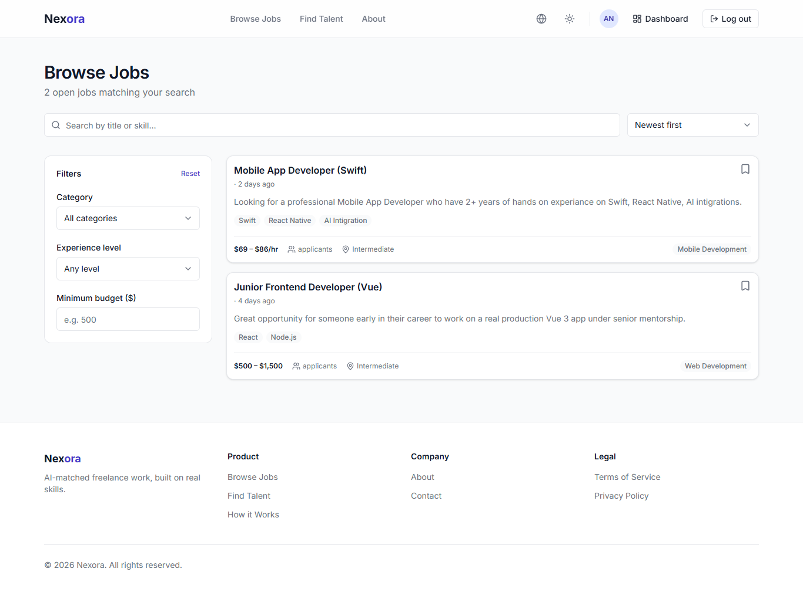
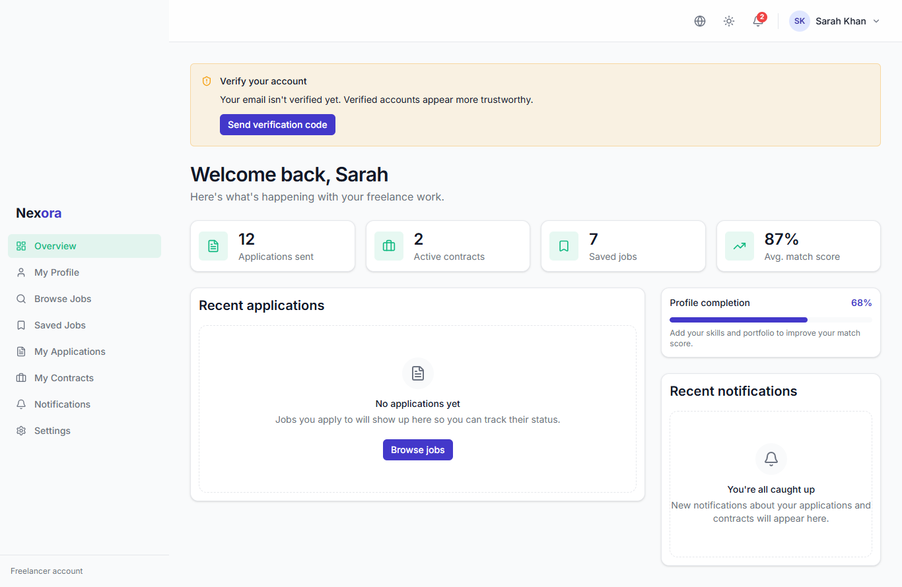
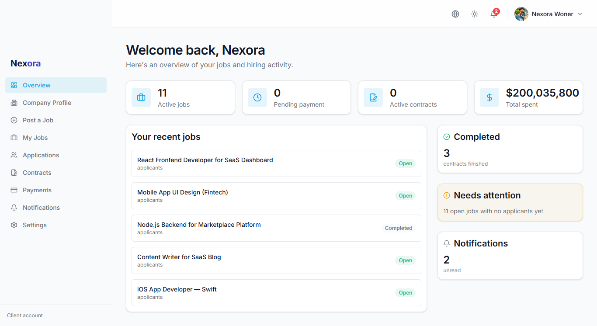
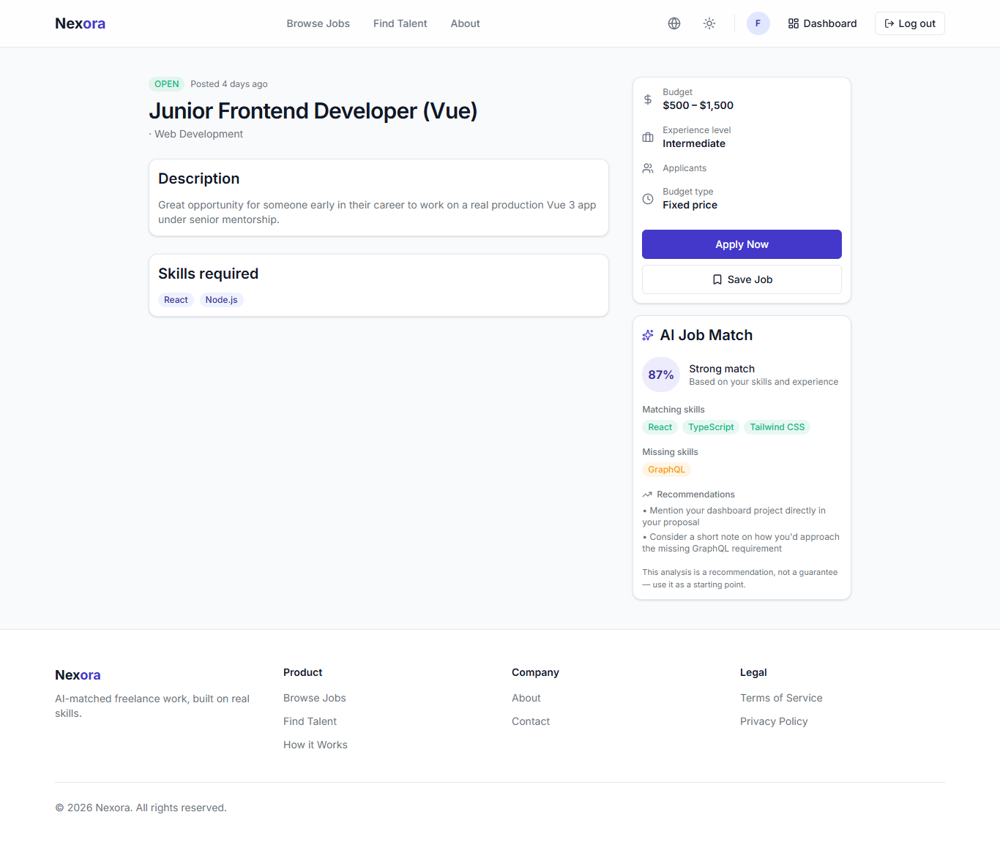
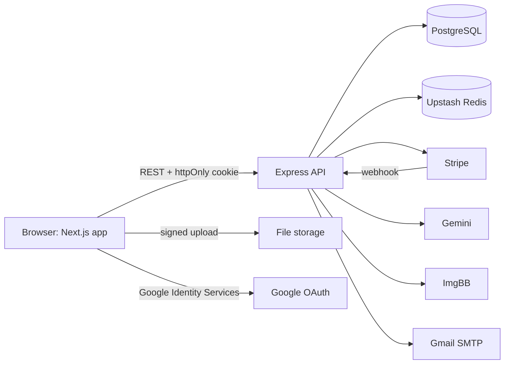
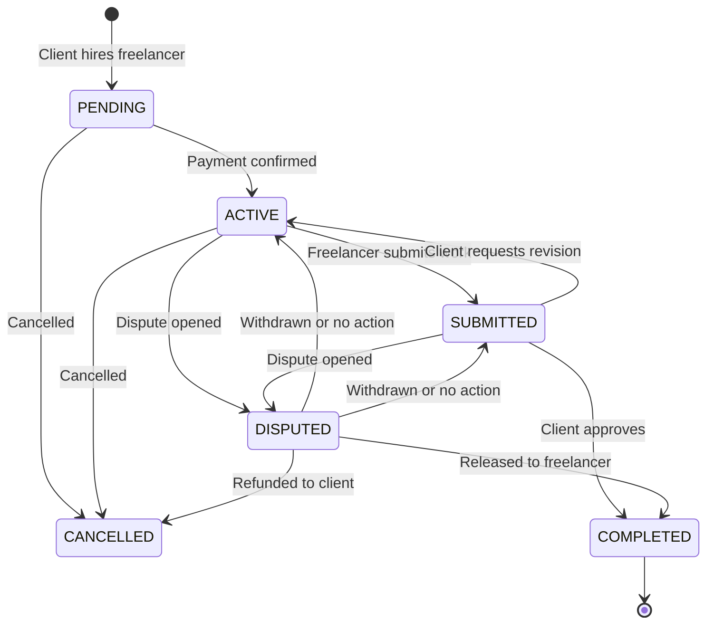
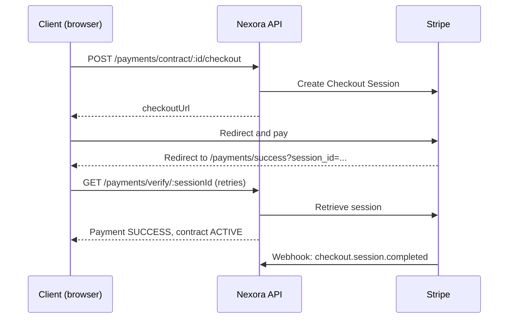

# Nexora

**An AI-powered freelance marketplace.** Freelancers see exactly how well they match a job before they apply. Clients and freelancers then move through hiring, secure payment, delivery, disputes and reviews on one platform, with messaging and an admin console built in.


**Live app:** https://find-nexora.vercel.app
**API:** https://nexora-marketplace-backend.vercel.app/api/v1

---

## Table of Contents

- [Overview](#overview)
- [Features](#features)
- [Screenshots](#screenshots)
- [Tech Stack](#tech-stack)
- [Architecture](#architecture)
- [Core Workflows](#core-workflows)
- [Authentication and Security](#authentication-and-security)
- [API Overview](#api-overview)
- [Getting Started](#getting-started)
- [Environment Variables](#environment-variables)
- [Scripts](#scripts)
- [Deployment](#deployment)
- [Roadmap](#roadmap)
- [Author](#author)

---

## Overview

Most freelance marketplaces work like search engines: freelancers scroll through hundreds of listings and clients wade through applicants, and neither side gets a real signal until the work has started.

Nexora compares a freelancer's profile with a job's requirements up front. It gives an instant rule-based match score, plus an optional deep AI analysis covering strengths, missing skills, and a recommendation. The rest of the platform carries that match through a complete project lifecycle: invitations and applications, hiring, secure payment, delivery with file attachments, disputes, reviews, and messaging between the two sides.

This is a full-stack portfolio project made of two repositories:

| Repository | Purpose |
|---|---|
| `nexora-marketplace` | Next.js frontend (this app) |
| `nexora-backend` | Express + Prisma REST API |

---

## Features

### For freelancers
- Professional profile with skills, experience, portfolio, availability, experience level, a profile photo, and a completion score
- Search and filter open jobs, save them, and see a **Matched Jobs** feed ranked by how well your skills fit
- **AI job match:** an instant rule-based score, plus an on-demand deep analysis (strengths, missing skills, recommendation)
- Apply with a cover letter, proposed budget and delivery estimate; accept **invitations** from clients; withdraw while pending or shortlisted
- **Messaging** with clients you have a job in common with
- Submit work with a note, a link, and up to 5 **file attachments**
- **Earnings** page with a recorded balance, platform fee breakdown, and a transaction history
- Open or withdraw **disputes** on active and submitted contracts
- Dashboard with a "needs your attention" list, application breakdown, earnings and profile completion

### For clients
- Company profile with industry, size, location, social links and a logo
- Post jobs as drafts, publish, edit, close or cancel
- **Find Talent:** search freelancers by skill, rate, experience, availability and rating, and **invite** them to an open job
- Review applicants across all jobs, shortlist, reject or hire; hiring creates a contract automatically
- Pay securely through Stripe Checkout, review submitted work and its files, approve or request a revision
- **Messaging** with applicants and invited freelancers
- Spending summary, payment history, and dashboards that flag payments due, work to review, drafts and quiet jobs
- Open or withdraw disputes

### For admins
- Platform overview: users, jobs, contracts, open disputes, revenue, platform fees, escrow and refunds
- User management with search, filters, and suspend / restore
- Job moderation: cancel or close open jobs
- A dispute queue with a resolution flow: refund the client, release to the freelancer, or take no action, with a required note and a refund result

### Platform
- Role-based access for Client, Freelancer and Admin
- Email OTP verification, forgot/reset password, Google sign-in, change password and account deletion
- Two-way reviews on completed contracts with public rating summaries
- In-app notifications and a polled unread badge for notifications and messages
- Light, dark and system themes; English and Bangla navigation
- Responsive layout with a mobile drawer, accessible dialogs, loading skeletons and clear error states

---

## Project Screenshots

** Job Marketplace **


** Freelancer Dashboard ** 


**Client Dashboard **


** AI Job Match **
 

---

## Tech Stack

### Frontend
| Area | Technology |
|---|---|
| Framework | Next.js (App Router), React, TypeScript |
| Styling | Tailwind CSS, class-variance-authority, tailwind-merge |
| Data fetching | TanStack Query |
| Forms and validation | React Hook Form, Zod |
| UI and motion | Framer Motion, Lucide icons, Sonner (toasts), next-themes |
| Images | react-easy-crop (avatar crop and rotate) |
| Tooling | ESLint, Prettier |

### Backend
| Area | Technology |
|---|---|
| Runtime and framework | Node.js, Express 5, TypeScript |
| Database | PostgreSQL with Prisma ORM |
| Cache and rate limiting | Upstash Redis |
| Auth | JWT in httpOnly cookies, Google OAuth |
| Payments | Stripe Checkout, webhooks and refunds |
| AI | Google Gemini (job match analysis) |
| Files and images | Signed direct uploads for submissions, ImgBB for avatars |
| Email | Gmail SMTP |
| Hosting | Vercel (serverless) |

---

## Architecture



### Frontend structure

The frontend uses a feature-based layout with thin route files.

```
src/
├── app/
│   ├── (public)/        # home, about, jobs, talent, public profiles, payment result pages
│   ├── (auth)/          # login, register, forgot/reset password
│   ├── (dashboard)/     # freelancer/*, client/* and admin/* areas
│   ├── suspended/       # screen for suspended accounts
│   └── error.tsx  loading.tsx  not-found.tsx
├── components/
│   ├── ui/              # primitives: button, input, card, dialog, badge...
│   ├── shared/          # navbar, footer, avatar, pagination...
│   ├── dashboard/       # sidebar, topbar, stat cards, notifications
│   ├── admin/           # admin shell and top bar
│   └── auth/            # protected route wrapper
├── features/            # auth, jobs, applications, invitations, messaging,
│                        # contracts, payments, disputes, profile, reviews,
│                        # ai-match, recommendations, talent, notifications,
│                        # dashboard, settings, admin, home
├── hooks/               # React Query hooks per domain
├── services/            # API calls and response normalizers per domain
├── providers/           # query, theme, language
├── lib/                 # api client, env validation, error handling, utils
└── types/               # shared enums and domain types
```

### Frontend conventions
- **One API client.** It unwraps the `{ success, message, data, meta }` envelope, always sends credentials, and throws a typed `ApiError` carrying field-level validation errors.
- **Centralized error handling.** 401 re-checks the session, 403 and 404 show toasts, 409 and 429 show warnings with per-action wording, 5xx shows a generic message, and "Account suspended" routes to its own screen.
- **Normalization at the service layer.** Backend shapes (relation rows, nested objects, nullable fields) are converted to flat, typed objects once, so components never deal with raw responses.
- **Polling, not sockets.** Messages, the unread badge and contract activation are polled with React Query, and polling pauses while the tab is hidden. The backend runs as serverless functions, which can't hold WebSocket connections.
- **Role checks are UX only.** `ProtectedRoute` sends people to the right area, but the backend remains the real authorization layer.
- **Environment validation.** `src/lib/env.ts` validates variables with Zod at startup.

---

## Core Workflows

### Contract lifecycle



A hired contract stays `PENDING` until payment is confirmed. Hiring also rejects the other applicants and moves the job to `IN_PROGRESS`. While a contract is disputed, submitting, approving, requesting revisions and cancelling are locked until an admin resolves the dispute or the person who opened it withdraws.

### Payment flow



The verify endpoint gives immediate feedback when the client lands back on the site. The webhook is the source of truth and covers cases where the client never returns. Freelancer earnings are net of a platform fee; they are a recorded balance and Nexora does not send payouts.

### Invitation flow
A client invites a freelancer from Find Talent or from their own job page. The freelancer sees it in their invitations page and can accept or decline. Accepting opens the job with the apply form ready, because an application needs a cover letter. Applying to the job settles the invitation.

### Messaging
A conversation is tied to a job and is allowed once the two people have an application, an invitation or a contract on it. The thread polls for new messages every few seconds while visible, keeps your reading position, and marks messages read when the other person's arrive.

### AI job match
1. **Quick score:** `GET /ai-match/jobs/:jobId/rule-based` is instant, makes no external call, and returns a score with a transparent breakdown.
2. **Deep analysis:** `POST /ai-match/jobs/:jobId/analyze` calls Gemini and is rate limited per user. It returns strengths, missing skills and a recommendation, and overwrites the previous analysis for that job.
3. **Saved result:** `GET /ai-match/jobs/:jobId/analysis` loads the stored analysis without spending quota.
4. **Matched Jobs feed:** `GET /jobs/recommended` scores open jobs against the freelancer's skills with the same matcher, cached per freelancer for a few minutes.

---

## Authentication and Security

- Sessions use a JWT in an **httpOnly cookie**, so there is no token in JavaScript or localStorage.
- Registration doesn't block login. Verification is a later, optional step done with an **emailed 6-digit OTP**.
- Password reset uses an emailed link with a token. Changing your password signs out your other devices.
- Google sign-in sends a Google ID token to the API; new Google users also choose a role.
- **Admins are seeded, never registered.** Suspended accounts get a 403 on every request and see a dedicated screen. Deleted accounts are anonymized and kept only for history.
- Rate limits cover register, login, password reset, OTP sending, change password, invitations, messages, file uploads and AI analysis.
- Uploaded submission files are public to anyone with the link, and the UI warns about this.
- CORS is restricted to the configured frontend origin.
- Authorization (role and ownership) is enforced on the server for every protected route.

---

## API Overview

Base URL: `/api/v1`. Every response uses the envelope `{ success, message, data, meta? }`.

| Module | Highlights |
|---|---|
| `/auth` | register, login, Google login, logout, OTP send/verify, forgot/reset and change password, `me` |
| `/users` | rename, avatar upload, delete account |
| `/profiles/freelancer` | directory search, profile CRUD, skills, experience, portfolio, public profile |
| `/profiles/client` | profile CRUD, public profile |
| `/jobs` | public search, recommended feed, CRUD, status changes, save/unsave |
| `/applications` | apply, withdraw, list by job, shortlist/reject |
| `/invitations` | invite, sent and received lists, respond, cancel |
| `/contracts` | hire, submit (with attachments), request revision, approve, cancel, open a dispute |
| `/disputes` | list, detail, withdraw |
| `/payments` | checkout, verify session, history, earnings, spending, Stripe webhook |
| `/reviews` | create per contract, list per user, rating summary |
| `/conversations`, `/messages` | open a conversation, list, send, mark read, unread count |
| `/notifications` | list, unread count, mark read, mark all read |
| `/dashboard` | freelancer and client stats |
| `/ai-match` | rule-based score, deep analysis, saved analysis |
| `/uploads` | sign a direct file upload |
| `/admin` | stats, users and suspension, jobs, disputes and resolution |

---

## Getting Started

### Prerequisites
- Node.js 20+
- A PostgreSQL database
- An Upstash Redis database
- A Stripe account (test mode)
- Optional: Google OAuth client ID, Gemini API key, ImgBB API key, a file-storage account for submission uploads

### 1. Backend

```bash
git clone <backend-repo-url> nexora-backend
cd nexora-backend
npm install
cp .env.example .env        # fill in the values
npx prisma migrate dev
npm run dev                 # http://localhost:5000
```

Create the admin account with the backend's seed script, using `ADMIN_EMAIL` and `ADMIN_PASSWORD` from `.env`. Admins can't register through the app.

### 2. Frontend

```bash
git clone <frontend-repo-url> nexora-marketplace
cd nexora-marketplace
npm install
cp .env.example .env.local  # fill in the values
npm run dev                 # http://localhost:3000
```

### 3. Stripe webhooks (local only)

Stripe can't reach `localhost`, so forward webhook events with the Stripe CLI:

```bash
stripe login
stripe listen --forward-to localhost:5000/api/v1/payments/webhook
```

Copy the `whsec_...` secret it prints into the backend `.env` as `STRIPE_WEBHOOK_SECRET`. Without this, webhooks never arrive. The success-page verify call still works without it.

---

## Environment Variables

### Frontend (`.env.local`)

| Variable | Required | Description |
|---|---|---|
| `NEXT_PUBLIC_API_URL` | Yes | API base URL including `/api/v1`, e.g. `http://localhost:5000/api/v1` |
| `NEXT_PUBLIC_GOOGLE_CLIENT_ID` | No | Enables the Google sign-in button |

### Backend (`.env`)

| Variable | Description |
|---|---|
| `FRONTEND_URL` | Allowed CORS origin and the base for Stripe success/cancel redirects |
| `STRIPE_SECRET_KEY` | Stripe secret key |
| `STRIPE_WEBHOOK_SECRET` | Webhook signing secret (the CLI secret locally, the dashboard secret in production) |
| `PLATFORM_FEE_PERCENT` | Platform fee taken from freelancer earnings (default 10) |
| `ADMIN_EMAIL`, `ADMIN_PASSWORD` | Credentials for the seeded admin account |

The backend also needs credentials for the database, JWT signing, Upstash Redis, Google OAuth, Gemini, ImgBB, the file-storage service for submissions, and SMTP. See `.env.example` in the backend repo for the full list.

> **CORS note:** requests only succeed from the origin set in `FRONTEND_URL`. When running the frontend on `localhost:3000` against a deployed API, that origin must be allowed too, or the browser will block the requests.

---

## Scripts

| Command | Description |
|---|---|
| `npm run dev` | Start the development server |
| `npm run build` | Production build |
| `npm run start` | Run the production build |
| `npm run lint` | Lint with ESLint |
| `npm run format` | Format with Prettier |
| `npm run format:check` | Check formatting |
| `npx tsc --noEmit` | Type-check without emitting files |

---

## Deployment

Both apps deploy to **Vercel**: the frontend as a Next.js app and the backend as a serverless function.

- Set `NEXT_PUBLIC_API_URL` on the frontend project to the deployed API URL.
- Set `FRONTEND_URL` on the backend project to the deployed frontend URL.
- In the Stripe dashboard, add a webhook endpoint pointing at `<API_URL>/api/v1/payments/webhook`, subscribe to `checkout.session.completed`, and use that endpoint's signing secret as `STRIPE_WEBHOOK_SECRET` in production.
- Add the deployed frontend origin to the Google OAuth client's authorized JavaScript origins.
- Serverless functions can't hold WebSocket connections, so live features use polling.

---

## Roadmap

**Shipped**
- [x] Authentication with OTP verification, Google sign-in and account management
- [x] Freelancer and client profiles with avatar upload
- [x] Job marketplace with search, filters, saved jobs and a matched-jobs feed
- [x] Freelancer directory and job invitations
- [x] Applications, hiring and the full contract lifecycle with file attachments
- [x] Stripe payments, earnings and platform fees
- [x] Messaging between clients and freelancers
- [x] Disputes with admin resolution and refunds
- [x] Admin console: overview, users, job moderation
- [x] Two-way reviews and public rating summaries
- [x] AI job matching (rule-based and Gemini)
- [x] Notifications and dashboards on dedicated stats endpoints

**Planned**
- [ ] Milestone-based payments for larger contracts
- [ ] Real payouts through Stripe Connect
- [ ] Email notifications and notification preferences
- [ ] Saved freelancers, job alerts and invoices
- [ ] Full Bangla translation beyond the navigation

---

## Author

**Md. Shanto Sarkar** — Full Stack Developer

- Portfolio: [shanto9070.vercel.app](https://shanto9070.vercel.app)
- GitHub: [@ShantoSarkar34](https://github.com/ShantoSarkar34)