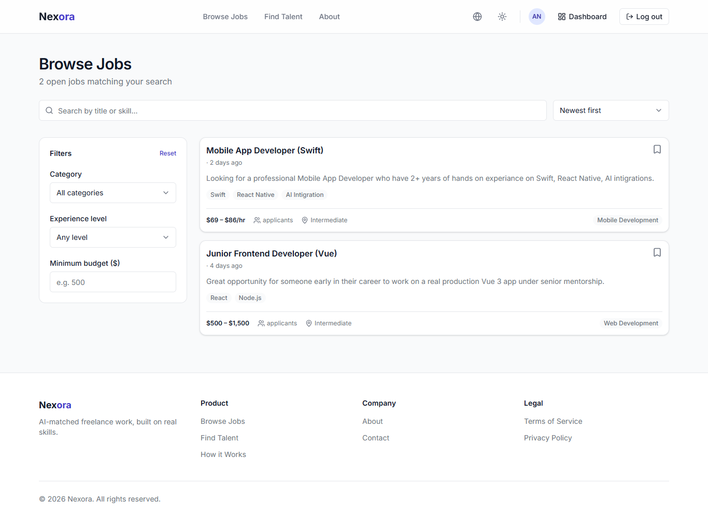
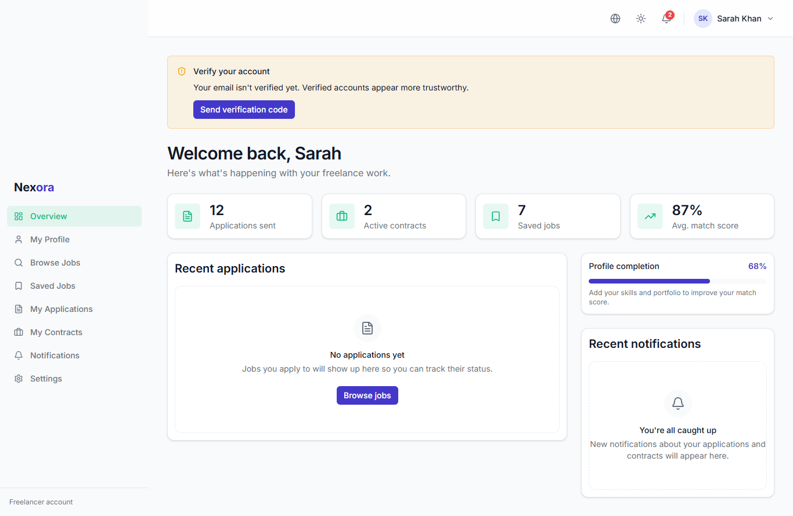
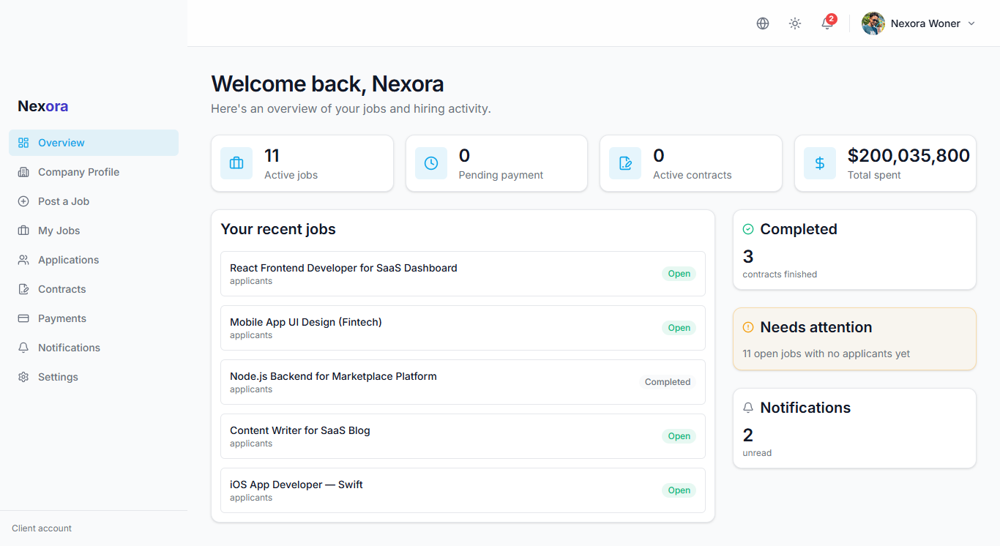
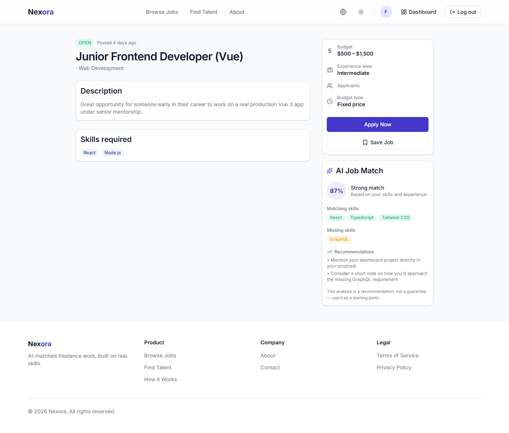
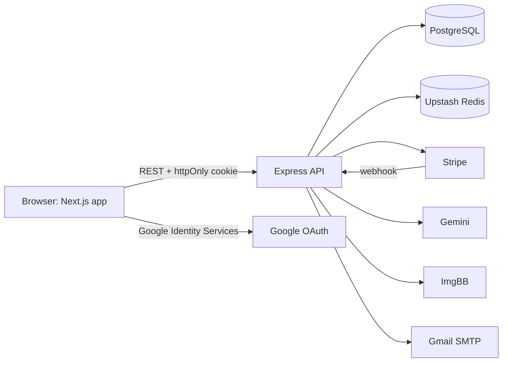
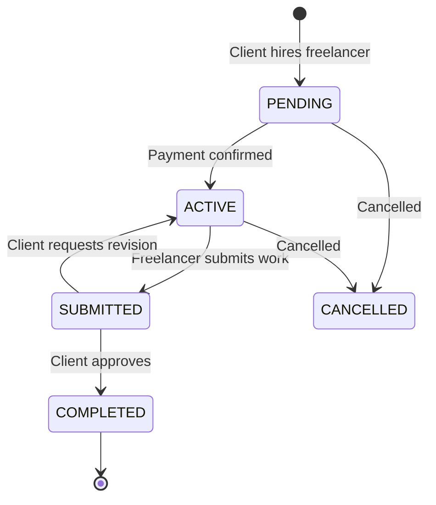
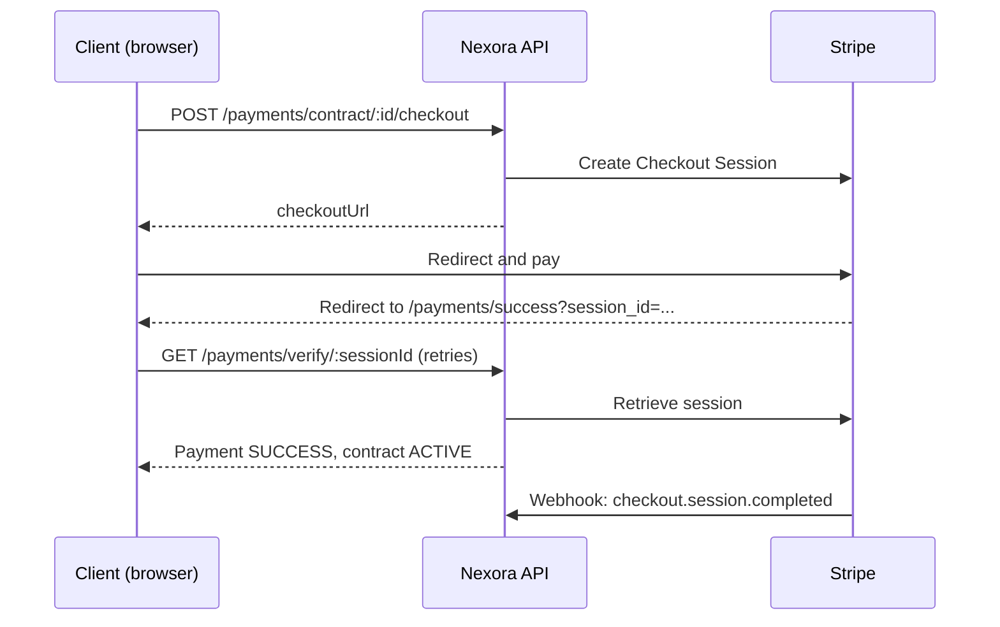

# Nexora

**An AI-powered freelance marketplace.** Freelancers see exactly how well they match a job before they apply. Clients get a clear path from hiring to payment to delivery.


**Live app:** https://find-nexora.vercel.app
**API:** https://nexora-marketplace-backend.vercel.app/api/v1

---

## Table of Contents

- [Overview](#overview)
- [Features](#features)
- [Screenshots](#screenshots)
- [Tech Stack](#tech-stack)
- [Architecture](#architecture)
- [Core Workflows](#core-workflows)
- [Authentication and Security](#authentication-and-security)
- [API Overview](#api-overview)
- [Getting Started](#getting-started)
- [Environment Variables](#environment-variables)
- [Scripts](#scripts)
- [Deployment](#deployment)
- [Roadmap](#roadmap)
- [Author](#author)

---

## Overview

Most freelance marketplaces work like search engines: freelancers scroll through hundreds of listings and clients wade through applicants, and neither side gets a real signal until the work has started.

Nexora compares a freelancer's profile against a job's requirements up front. It gives an instant rule-based match score, plus an optional deep AI analysis covering strengths, missing skills, and a recommendation. The rest of the platform carries that match through a complete project lifecycle: applications, hiring, secure payment, delivery, approval, and reviews.

This is a full-stack portfolio project made of two repositories:

| Repository | Purpose |
|---|---|
| `nexora-marketplace` | Next.js frontend (this app) |
| `nexora-backend` | Express + Prisma REST API |

---

## Features

### For freelancers
- Professional profile with skills, work experience, portfolio projects, profile photo, and a completion score
- Search and filter open jobs by keyword, category, experience level, and budget
- Save jobs and review them later
- **AI job match:** an instant rule-based score, plus an on-demand deep analysis (strengths, missing skills, recommendation)
- Apply with a cover letter, proposed budget, and delivery estimate; withdraw while the application is pending or shortlisted
- Track applications by status: Pending, Shortlisted, Hired, Rejected, Withdrawn
- Manage contracts, submit work, and leave reviews
- Dashboard with application stats, active contracts, saved jobs, and notifications

### For clients
- Company profile with industry, size, location, social links, and logo
- Post jobs as drafts, publish when ready, edit, and cancel or close
- Review applicants across all jobs or per job, with status and date filters
- Shortlist, reject, or hire; hiring creates a contract automatically
- Pay securely through Stripe Checkout
- Approve submitted work or request a revision
- Spending history and a dashboard that flags drafts and jobs with no applicants

### Platform
- Role-based access for Client, Freelancer, and Admin
- Email OTP verification, forgot/reset password, and Google sign-in
- Two-way reviews on completed contracts, with public rating summaries
- In-app notifications with a polled unread badge
- Light, dark, and system themes, with an English/Bangla language switcher
- Responsive layout with a mobile drawer navigation

---


## Project Screenshots

| Landing Page | Job Marketplace |
|---|---|
|  |

| Freelancer Dashboard | Client Dashboard |
|---|---|
|  |  |

| AI Job Match |
|---|---|
|  |

---


## Tech Stack

### Frontend
| Area | Technology |
|---|---|
| Framework | Next.js (App Router), React, TypeScript |
| Styling | Tailwind CSS, class-variance-authority, tailwind-merge |
| Data fetching | TanStack Query |
| Forms and validation | React Hook Form, Zod |
| UI and motion | Framer Motion, Lucide icons, Sonner (toasts), next-themes |
| Images | react-easy-crop (avatar crop and rotate) |
| Tooling | ESLint, Prettier |

### Backend
| Area | Technology |
|---|---|
| Runtime and framework | Node.js, Express 5, TypeScript |
| Database | PostgreSQL with Prisma ORM |
| Cache and rate limiting | Upstash Redis |
| Auth | JWT in httpOnly cookies, Google OAuth |
| Payments | Stripe Checkout and webhooks |
| AI | Google Gemini (job match analysis) |
| Email | Gmail SMTP |
| Image hosting | ImgBB |
| Hosting | Vercel (serverless) |

---

## Architecture



### Frontend structure

The frontend uses a feature-based layout with thin route files.

```
src/
├── app/
│   ├── (public)/        # home, about, jobs, public profiles, payment result pages
│   ├── (auth)/          # login, register, forgot/reset password
│   ├── (dashboard)/     # freelancer/* and client/* role dashboards
│   ├── error.tsx  loading.tsx  not-found.tsx
├── components/
│   ├── ui/              # primitives: button, input, card, dialog, badge...
│   ├── shared/          # navbar, footer, avatar, pagination...
│   ├── dashboard/       # sidebar, topbar, stat cards, notifications
│   └── auth/            # protected route wrapper
├── features/            # auth, jobs, applications, contracts, payments,
│                        # profile, reviews, ai-match, notifications, settings
├── hooks/               # React Query hooks per domain
├── services/            # API calls per domain
├── providers/           # query, theme, language
├── lib/                 # api client, env validation, error handling, utils
└── types/               # shared enums and domain types
```

### Frontend conventions
- **One API client.** It unwraps the `{ success, message, data, meta }` envelope, always sends credentials, and throws a typed `ApiError` carrying field-level validation errors.
- **Centralized error handling.** 401 redirects to login, 403 and 404 show toasts, 409 and 429 show warnings, and 5xx shows a generic message. Mutations only need to handle their own field errors.
- **Normalization at the service layer.** Backend shapes (relation rows, string decimals, nested objects) are converted to flat, typed objects once, so components never deal with raw responses.
- **Role checks are UX only.** `ProtectedRoute` redirects the wrong role, but the backend remains the real authorization layer.
- **Environment validation.** `src/lib/env.ts` validates variables with Zod at startup.

---

## Core Workflows

### Contract lifecycle



A hired contract stays `PENDING` until payment is confirmed. Hiring also rejects the other applicants and moves the job to `IN_PROGRESS`. Approving the work completes the contract and the job together.

### Payment flow



The verify endpoint gives immediate feedback when the client lands back on the site. The webhook is the source of truth and covers cases where the client never returns.

### AI job match
1. **Quick score:** `GET /ai-match/jobs/:jobId/rule-based` is instant, makes no external call, and returns a score with a transparent breakdown.
2. **Deep analysis:** `POST /ai-match/jobs/:jobId/analyze` calls Gemini and is rate limited per user. It returns strengths, missing skills, and a recommendation, and overwrites the previous analysis for that job.
3. **Saved result:** `GET /ai-match/jobs/:jobId/analysis` loads the stored analysis without spending quota.

---

## Authentication and Security

- Sessions use a JWT in an **httpOnly cookie**, so there is no token in JavaScript or localStorage.
- Registration doesn't block login. Verification is a later, optional step done with an **emailed 6-digit OTP**.
- Password reset uses an emailed link with a token.
- Google sign-in sends a Google ID token to the API; new Google users also choose a role.
- Rate limits cover register, login, forgot-password, OTP sending, and AI analysis.
- CORS is restricted to the configured frontend origin.
- Authorization (role and ownership) is enforced on the server for every protected route.

---

## API Overview

Base URL: `/api/v1`. Every response uses the envelope `{ success, message, data, meta? }`.

| Module | Highlights |
|---|---|
| `/auth` | register, login, Google login, logout, OTP send/verify, forgot/reset password, `me` |
| `/users` | avatar upload |
| `/profiles/freelancer` | profile CRUD, skills, experience, portfolio, public profile |
| `/profiles/client` | profile CRUD, public profile |
| `/jobs` | public search with filters and pagination, CRUD, status changes, save/unsave |
| `/applications` | apply, withdraw, list by job, shortlist/reject |
| `/contracts` | hire, activate, submit, request revision, approve, cancel |
| `/payments` | checkout, verify session, history, Stripe webhook |
| `/reviews` | create per contract, list per user, rating summary |
| `/ai-match` | rule-based score, deep analysis, saved analysis |
| `/notifications` | list, unread count, mark read, mark all read |

---

## Getting Started

### Prerequisites
- Node.js 20+
- A PostgreSQL database
- An Upstash Redis database
- A Stripe account (test mode)
- Optional: Google OAuth client ID, Gemini API key, ImgBB API key

### 1. Backend

```bash
git clone <backend-repo-url> nexora-backend
cd nexora-backend
npm install
cp .env.example .env        # fill in the values
npx prisma migrate dev
npm run dev                 # http://localhost:5000
```

### 2. Frontend

```bash
git clone <frontend-repo-url> nexora-marketplace
cd nexora-marketplace
npm install
cp .env.example .env.local  # fill in the values
npm run dev                 # http://localhost:3000
```

### 3. Stripe webhooks (local only)

Stripe can't reach `localhost`, so forward webhook events with the Stripe CLI:

```bash
stripe login
stripe listen --forward-to localhost:5000/api/v1/payments/webhook
```

Copy the `whsec_...` secret it prints into the backend `.env` as `STRIPE_WEBHOOK_SECRET`. Without this, webhooks never arrive. The success-page verify call still works without it.

---

## Environment Variables

### Frontend (`.env.local`)

| Variable | Required | Description |
|---|---|---|
| `NEXT_PUBLIC_API_URL` | Yes | API base URL including `/api/v1`, e.g. `http://localhost:5000/api/v1` |
| `NEXT_PUBLIC_GOOGLE_CLIENT_ID` | No | Enables the Google sign-in button |

### Backend (`.env`)

| Variable | Description |
|---|---|
| `FRONTEND_URL` | Allowed CORS origin and the base for Stripe success/cancel redirects |
| `STRIPE_SECRET_KEY` | Stripe secret key |
| `STRIPE_WEBHOOK_SECRET` | Webhook signing secret (the CLI secret locally, the dashboard secret in production) |

The backend also needs credentials for the database, JWT signing, Upstash Redis, Google OAuth, Gemini, ImgBB, and SMTP. See `.env.example` in the backend repo for the full list.

> **CORS note:** requests only succeed from the origin set in `FRONTEND_URL`. When running the frontend on `localhost:3000` against a deployed API, that origin must be allowed too, or the browser will block the requests.

---

## Scripts

| Command | Description |
|---|---|
| `npm run dev` | Start the development server |
| `npm run build` | Production build |
| `npm run start` | Run the production build |
| `npm run lint` | Lint with ESLint |
| `npm run format` | Format with Prettier |
| `npm run format:check` | Check formatting |
| `npx tsc --noEmit` | Type-check without emitting files |

---

## Deployment

Both apps deploy to **Vercel**: the frontend as a Next.js app and the backend as a serverless function.

- Set `NEXT_PUBLIC_API_URL` on the frontend project to the deployed API URL.
- Set `FRONTEND_URL` on the backend project to the deployed frontend URL.
- In the Stripe dashboard, add a webhook endpoint pointing at `<API_URL>/api/v1/payments/webhook`, subscribe to `checkout.session.completed`, and use that endpoint's signing secret as `STRIPE_WEBHOOK_SECRET` in production.
- Vercel serverless can't hold WebSocket connections, so live features such as notifications use polling.

---

## Roadmap

**Shipped**
- [x] Authentication with OTP verification and Google sign-in
- [x] Freelancer and client profiles with avatar upload
- [x] Job marketplace with search, filters, and saved jobs
- [x] Applications, hiring, and the full contract lifecycle
- [x] Stripe payments with session verification
- [x] Two-way reviews and public rating summaries
- [x] AI job matching (rule-based and Gemini)
- [x] Notifications

**Planned**
- [ ] Freelancer directory and search
- [ ] Job invitations
- [ ] Client and freelancer messaging
- [ ] Freelancer earnings and platform fee
- [ ] Disputes and an admin panel
- [ ] Personalized job feed
- [ ] File attachments on work submissions
- [ ] Full Bangla translation beyond the navigation

---

## Author

**Md. Shanto Sarkar** — Full Stack Developer

- Portfolio: [shanto9070.vercel.app](https://shanto9070.vercel.app)
- GitHub: [@ShantoSarkar34](https://github.com/ShantoSarkar34)